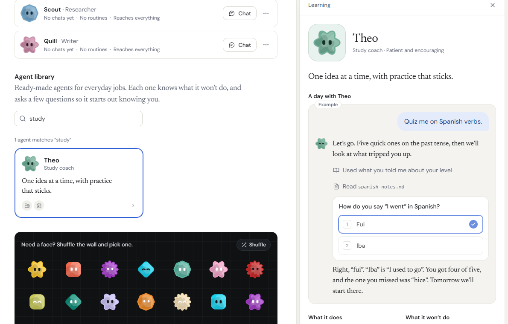

<div align="center">


# Melete

### A personal agent for the life you're building.

The project you're building. The skill you're learning. The trip taking shape.

**Bring your context. Work through a bigger goal. Turn the result into plans, files, and useful apps you can come back to.**

Open source. Self-hosted. Your choice of model.

[](https://github.com/ychampion/melete/releases) [](LICENSE) [](https://github.com/ychampion/melete/actions/workflows/ci.yml)

[**Self-host now**](#get-started) · [**Join the Cloud waitlist**](https://waitlist.melete.si) · [**Try a playbook**](docs/PLAYBOOKS.md) · [**Explore the Spaces proposal**](docs/SPACES.md)

</div>


<p align="center"><em>A browser, terminal, and files of its own. Watch it work. Take the wheel. Hand it back.</em><br />
<a href="docs/assets/readme/computer.mp4">Watch the clip</a> · <a href="docs/assets/readme/computer.png">Open the screenshot</a></p>

## Why Melete?

Your life has more than one thread. A side project needs research and files. Learning needs practice and a sense of progress. Travel needs decisions, preferences, and a plan you can actually use.

Melete brings **personal context and working tools** together. Keep the preferences you've already explained, work through a longer goal, and turn the result into something you can reopen or use. Your memory and work live in your installation, across your choice of models.

| What you want | What Melete brings together |
| --- | --- |
| **Start with an agent that knows you** | Bring a reviewed preferences file from your current assistant. Inspect, correct, export, and import memory as your life changes. |
| **Make progress on something bigger** | Plans, milestones, persistent goals, and long work that resumes in shifts. Runs retain findings and attempts, then check the result against explicit completion criteria. |
| **Use the accounts and tools you already have** | Connected mail and calendars, MCP tools, its own computer, and optional access to your signed-in browser and shared local folders. |
| **Keep the relationship when you change models** | Inspectable memory with sources, correction, forgetting, Markdown/JSON export and import. Switch providers while your context stays in Melete. |
| **Keep something more useful than a transcript** | Saved files, downloadable run records, and private apps whose data can be refreshed by routines. Turn a recurring need into a small tool of your own. |
| **Choose the amount of autonomy** | Drafts, approval cards, per-kind sending preferences, action receipts, and undo for supported actions. Give a routine room to work and keep the decisions that matter. |
| **Own and extend the whole thing** | Apache-2.0 source, Docker deployment, a typed API, and an MCP server your other assistants can use. |

Looking at **Dots, Grok Bot, Claude Duet, OpenClaw, or Hermes**? [Compare the approaches](docs/PERSONAL-AGENTS.md). Melete brings your personal context, ongoing work, and useful outputs into a workspace you can own and shape.

## Next: personal Spaces

**A place for each part of your life, kept useful by your agent.** This is the next experience we're proposing for Melete.

Open **Learn Spanish**, **Launch my portfolio**, or **Kyoto in October** and return to the current plan, decisions, files, and next step together. Drop in a note or link; Melete proposes where it belongs and what it changes. Come back a week later and see what's moved, what's still open, and where to begin.

The aim is an agent that helps maintain your projects: it keeps the brief current, remembers why you made a decision, and shows which parts of the plan need revisiting when your priorities change.

[Explore the Spaces experience and first build slice →](docs/SPACES.md)

*Personal Spaces is a design proposal. The features below are available today.*

## A workspace that knows the next step

<table>
<tr>
<td width="50%" valign="top">
<h3>Work with a finish line</h3>
<p>See what's running, waiting on you, or scheduled. Longer jobs keep findings and attempts across shifts, then check the result against the goal.</p>
<a href="docs/assets/readme/work.png"></a>
<p><a href="docs/RUNS.md">Long work →</a></p>
</td>
<td width="50%" valign="top">
<h3>Context that compounds</h3>
<p>Bring preferences from your current assistant, add what matters, and correct it as life changes. See where a memory came from and take it with you.</p>
<a href="docs/assets/readme/memory.png"></a>
<p><a href="docs/BRING-YOUR-CONTEXT.md">Bring your context →</a></p>
</td>
</tr>
<tr>
<td width="50%" valign="top">
<h3>Your apps, in reach</h3>
<p>Mail, calendars, connected apps, and remote or packaged MCP servers. Choose what each agent can reach, then combine those tools in the same job.</p>
<a href="docs/assets/readme/connections.png"></a>
<p><a href="docs/CONNECTORS.md">Connections →</a></p>
</td>
<td width="50%" valign="top">
<h3>Begin with a useful setup</h3>
<p>Choose an agent from the library. Preview its brief and connections, answer a few preferences, and personalise it around a real goal.</p>
<a href="docs/assets/readme/library.png"></a>
<p><a href="docs/START-HERE.md#4-connect-one-account-that-makes-it-useful">Your first session →</a></p>
</td>
</tr>
</table>

### A computer that can do the rest

Melete can open websites, fill forms, run code, and work with files. Its own Linux computer comes with the standard Docker install. Watch the browser beside the conversation, take over for a human step, and give control back.

Pair your own computer when the job needs your signed-in browser or folders you choose to share. Cloud sandboxes are another option.

[Its own computer](docs/sandbox-docker.md) · [Your computer](docs/DEVICES.md) · [Browser and takeover](docs/browser-worker.md)

### Start with an agent that has a job

The **Agent library** gives you ready-made agents for everyday work. Preview the brief, see the connections it needs, answer a few preference questions, and choose whether to enable its starter routine. Personalise the setup around your life instead of writing the whole brief from scratch.

[First-session guide](docs/START-HERE.md#4-connect-one-account-that-makes-it-useful)

### Notice the change that matters

Mail and calendar watches can wake work when something changes. Follow a reply, keep a deadline attached to a goal, or set a recurring brief. Long work continues while the tab is closed, as long as the Melete host stays on.

[Watching for changes](docs/SITUATIONAL-AWARENESS.md) · [Persistent goals](docs/INTENTS.md) · [Long runs](docs/RUNS.md)

### Build the little tools your life needs

Ask for a trip dashboard, a learning log, or a tool for your side project. Melete can build an app you open inside your installation, connect it to files a routine updates, and keep earlier versions available. You choose who on your installation can open it.

[Apps and live data](docs/APPS.md) · [A personal-tool playbook](docs/PLAYBOOKS.md#build-a-little-tool-for-your-life)

### Keep your other assistants in the loop

Use Melete from ChatGPT, Claude, Claude Code, Hermes, OpenClaw, or another MCP client. Let them recall saved context, save a preference you've reviewed, propose an email for approval, and check the status of work.

Melete becomes a shared personal resource for the assistants you choose. [Connect an assistant](docs/MCP-SERVER.md).

Also built in: **voice conversations**, **plans and routines**, **approval controls**, and **undo for supported actions**. [Voice](docs/VOICE.md) · [Undo](docs/UNDO.md)

## Put it to work

Start with a situation you actually have. These are prompts to adapt to your own accounts and connected tools:

| Situation | Try this |
| --- | --- |
| **You want to learn, then keep going** | “Help me learn conversational Spanish in four weeks. Use my available time and interests. Save a practice plan, prepare the first session, and propose a weekly review.” |
| **Your side project lives in scattered notes** | “Turn these notes into a launch brief. Research the options, record the decisions I make, and save a first milestone plan I can work from.” |
| **A trip should feel like yours** | “Plan Kyoto around my saved travel preferences. Compare neighbourhoods and build a sourced itinerary. Show which decisions still need me.” |
| **A comparison needs real work** | “Compare these courses against my goals and schedule. Save your sources and recommendation in a file. Check the result against every requirement.” |
| **You need a calm start to the day** | “At 8:30 on weekdays, give me a brief from my connected inbox and calendar: today's commitments, replies that need me, and what could slip. Keep it short.” |
| **Your progress needs its own interface** | “Build a private learning log from these practice records. Show sessions, topics, and progress. Bind it to a data file I can update through a routine.” |

[Step-by-step playbooks, connection requirements, and completion checks →](docs/PLAYBOOKS.md)

## Get started

### Choose where Melete lives

| Run it | Best for | Start here |
| --- | --- | --- |
| **Your laptop or desktop** | Trying it, using local files, and keeping the installation close | Docker on macOS, Windows, or Linux; commands below |
| **An always-on machine or VPS** | Background jobs and routines while your laptop is asleep | [Server setup](docs/DEPLOYMENT.md#on-a-cloud-vm) · [Private access with Tailscale](docs/DEPLOYMENT.md#tailscale) |
| **Melete Cloud** | A hosted Melete without maintaining the server yourself | [Join the Cloud waitlist](https://waitlist.melete.si) |
| **A development checkout** | Changing the interface, tools, or runtime | [Contributing](CONTRIBUTING.md) · [Forking](FORKING.md) |

### Self-host with Docker

You need **Docker Engine 28+ and Compose 2.33.1+**, with Docker running. On Windows, use Docker Desktop with Linux containers and [Git for Windows](https://gitforwindows.org/).

The prebuilt installer below uses **x64 (`linux/amd64`) images**. On Apple silicon or another ARM host, use the [source-build setup](SETUP-WITH-AN-AGENT.md) and [architecture guidance](docs/DEPLOYMENT.md#using-prebuilt-images).

**macOS / Linux**

```bash
curl -fsSL https://raw.githubusercontent.com/ychampion/melete/main/install.sh | bash
```

**Windows PowerShell**

```powershell
irm https://raw.githubusercontent.com/ychampion/melete/main/install.ps1 | iex
```

The installer pulls prebuilt images and starts the stack; you don't need a source checkout or Bun. Open the setup link it prints and create your account. The default address is **http://localhost:3101**.

1. **Connect a model** in **Settings → Models**. The practice model lets you explore the interface before adding one.
2. **Bring your context** through **Memory → Import**, or tell Melete a few preferences in chat.
3. **Choose a ready-made agent** in the **Agent library**, or use your existing one.
4. **Add the sources your first task needs**: files, links, or one useful account in **Settings → Connections**.
5. **Try one playbook** and review the work and its sources.

Run the same installer command again to update; it preserves your settings and data volumes. [Start here](docs/START-HERE.md) covers the first useful session. [Deployment](docs/DEPLOYMENT.md#one-line-install) covers install options, HTTPS, servers, backups, and troubleshooting.

### Let your coding agent set it up

Paste this into Claude Code, Codex, Cursor, or another coding agent:

```text
Set up my personal Melete using this guide:
https://github.com/ychampion/melete/blob/main/docs/START-HERE.md

Check this machine, its architecture, and any existing installation first.
Use the recommended Docker install for x64, or the source-build guide for
ARM. Keep existing data and services intact.
Have me enter credentials directly in Melete, never in chat.
After it runs, help me prepare a reviewed preferences file using
docs/BRING-YOUR-CONTEXT.md and complete one playbook from docs/PLAYBOOKS.md.
```

[Detailed coding-agent setup](SETUP-WITH-AN-AGENT.md) · [Claude Code setup skill](skills/README.md)

### Bring the context you've already built

Ask the assistant that already knows you:

```text
Create a short preferences file for my new personal agent, Melete.
Use only current facts and preferences I explicitly told you.
Use headings Preferences, People, Work, or Routines and dates.
Format each item exactly as: - **Short label**: One factual sentence.
Include communication style, timezone, routines, and current priorities
where known. Leave out guesses, secrets, and raw conversation history.
Show me the Markdown to review before I import it.
```

Save the reviewed Markdown and choose **Memory → Import**. Melete also imports its own JSON memory exports. [The context guide](docs/BRING-YOUR-CONTEXT.md) includes a template, a first-chat prompt, and direct transfer through MCP.

## Your model. Your context.

Choose a provider in **Settings → Models**, test the connection, and switch without restarting. Your stored memory, conversations, and work stay in Melete.

| Provider | Connect with |
| --- | --- |
| Fireworks | API key |
| Anthropic | API key |
| OpenAI | API key |
| Google | API key |
| ChatGPT | Sign in with your account |
| OpenAI-compatible | Endpoint and key, including a model server on your own network |

Self-hosting gives you control of the installation and its data. Model calls and connected services use the providers you configure. [Provider setup](docs/DEPLOYMENT.md#providers) · [Privacy](docs/PRIVACY-AND-ISOLATION.md)

Mail and calendar connections live in **Settings → Connections**. Managed app sign-in through Composio, Google/Microsoft OAuth, cloud sandboxes, and ElevenLabs voice have their own operator configuration. [Connection options](docs/CONNECTORS.md).

## Melete Cloud

Want Melete running while your own machines are off, without operating the stack? **[Join the Melete Cloud waitlist](https://waitlist.melete.si)** for hosted access updates. You can self-host today while Cloud access is opening.

## What we're building toward

Personal Spaces that your agent helps maintain. A useful return brief when you pick a project back up. Decisions remembered with their reasons. More of your existing context on day one, and portable setups that make the first session feel like yours.

[The proposed roadmap](docs/ROADMAP.md) spells out these next steps, what already works, and what each new feature would unlock. Bring a use case, choose a proposal, or help build it.

## Build on Melete

Melete is built with **TypeScript, React, Hono, Postgres, and Hermes Agent**. Change the interface, add a connector, build a client, or run your own branded version.

| Layer | Where to look |
| --- | --- |
| Web app | [`apps/web`](apps/web) |
| Service, jobs, connections, and memory | [`apps/melete`](apps/melete) |
| Agent runtime | [`packages/runtime-hermes`](packages/runtime-hermes) |
| API contracts and typed client | [`packages/contracts`](packages/contracts) · [`packages/client`](packages/client) |
| Your computer's companion | [`packages/device`](packages/device) |
| Deployment | [`deploy`](deploy) |

[Contributing](CONTRIBUTING.md) · [Forking](FORKING.md) · [Architecture](docs/ARCHITECTURE.md) · [Build a client](docs/CLIENT.md)

## Documentation

| Get something done | Understand and extend it |
| --- | --- |
| [First useful session](docs/START-HERE.md) · [Bring your context](docs/BRING-YOUR-CONTEXT.md) | [Personal-agent comparison](docs/PERSONAL-AGENTS.md) · [Proposed roadmap](docs/ROADMAP.md) |
| [Playbooks and prompts](docs/PLAYBOOKS.md) · [Setup with an agent](SETUP-WITH-AN-AGENT.md) | [Memory](docs/MEMORY.md) · [Learning](docs/LEARNING.md) |
| [Install and deploy](docs/DEPLOYMENT.md) · [Upgrade](docs/UPGRADING.md) | [Long work](docs/RUNS.md) · [Watching changes](docs/SITUATIONAL-AWARENESS.md) |
| [Connections](docs/CONNECTORS.md) · [Mail and calendars](docs/mail-calendar.md) | [Voice](docs/VOICE.md) · [MCP server](docs/MCP-SERVER.md) |
| [Your computer](docs/DEVICES.md) · [Agent computer](docs/sandbox-docker.md) | [Privacy](docs/PRIVACY-AND-ISOLATION.md) · [Threat model](docs/THREAT-MODEL.md) |
| [Report a problem](docs/FEEDBACK.md) · [Request a feature](https://github.com/ychampion/melete/issues) | [Security policy](SECURITY.md) · [Changelog](CHANGELOG.md) · [Media notes](docs/assets/readme/README.md) |

## License and credits

[Apache-2.0](LICENSE). See [NOTICE](NOTICE) for attribution.

Melete's agent runtime is built on [Hermes Agent](https://github.com/NousResearch/hermes-agent) by Nous Research, customised for Melete.

If this is the personal agent you want to exist, **star the repo**, try a playbook, and tell us what you'd put it to work on.
