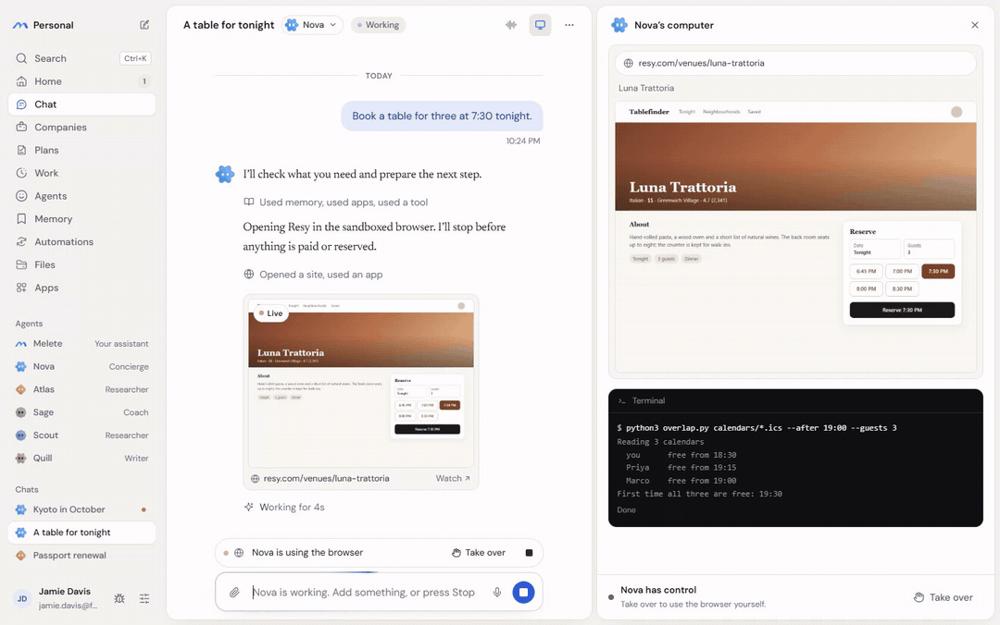
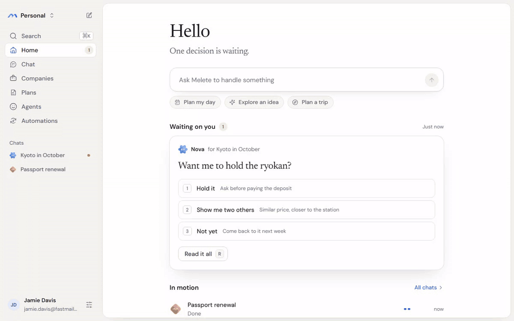
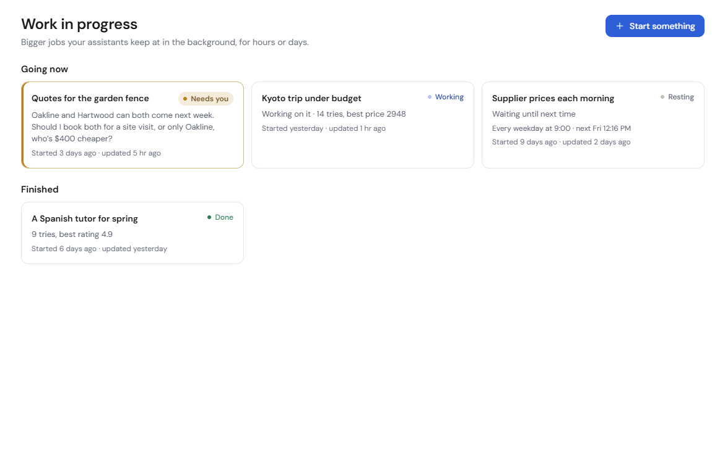
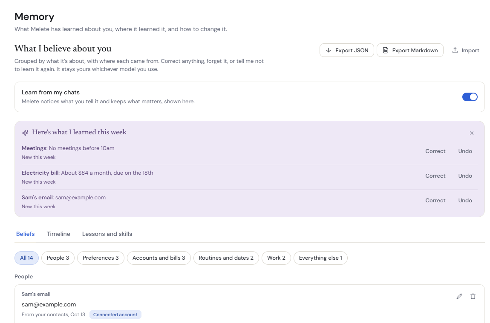
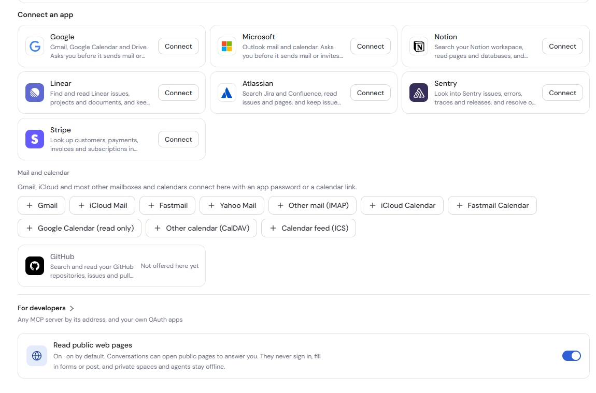
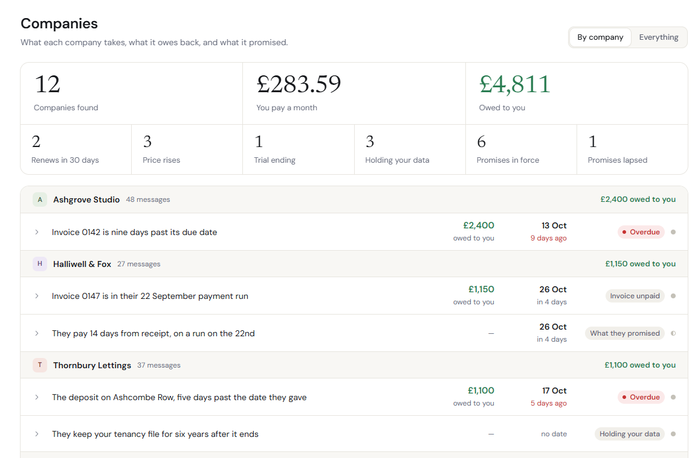

<div align="center">


# Melete

### Personal superintelligence that runs as you.

Hand it the job. Melete works across your apps, uses a computer, and follows through while you get on with your day.

**Open source · Self-hosted · Your choice of model**

[](https://github.com/ychampion/melete/releases) [](LICENSE) [](https://github.com/ychampion/melete/actions/workflows/ci.yml)

[**Get started**](#get-started) · [**See what it does**](#give-it-the-job-it-keeps-working) · [**Website**](https://melete.si) · [**Docs**](#documentation)

</div>



<p align="center"><em>Watch, take over, hand it back. A sample booking workflow.</em><br />
<a href="docs/assets/readme/computer.mp4">Watch the clip</a> · <a href="docs/assets/readme/computer.png">Open the screenshot</a></p>

## A computer of its own

Melete can open sites, fill forms, run code, and work with files. Watch its browser beside the conversation, take over when you need to, and hand it back.

Its own Docker computer comes with the standard install. You can also connect a cloud sandbox, or pair your own machine to use your signed-in browser and the folders you share.

[Its own computer](docs/sandbox-docker.md) · [Your computer](docs/DEVICES.md) · [Browser and takeover](docs/browser-worker.md)

## Give it the job. It keeps working.

“Chase the refund.” “Compare these quotes.” “Keep an eye on this and tell me when it changes.”

Melete reads the context, does the work, and keeps hold of the next step. Close the tab; long work continues. When it needs a decision, it brings that decision back to you.

- **Work across your accounts.** Mail, calendars, files, connected apps, and the browser you're already signed into.
- **Follow through.** Watch connected mail and calendars for replies and changes, run scheduled routines, and pick up long jobs in shifts.
- **Choose how much it handles.** Review drafts, or choose what it may send on its own. See the work, its sources, and the record of what changed.



<p align="center"><em>A refund, from “chase this” to settled. Demo workspace with sample data.</em><br />
<a href="docs/assets/readme/follow-through.mp4">Watch the clip</a> · <a href="docs/assets/readme/walkthrough/03-hand-it-one.png">Open the screenshot</a></p>

## More than a conversation

<table>
<tr>
<td width="50%" valign="top">
<h3>Keep the whole job in view</h3>
<p>Long research, a recurring check, a decision waiting on you. See what's running and return to the conversation behind it.</p>
<a href="docs/assets/readme/work.png"></a>
<p><a href="docs/RUNS.md">Long work →</a></p>
</td>
<td width="50%" valign="top">
<h3>Memory you can change</h3>
<p>Preferences and useful context stay with you. See where a memory came from, correct it, or tell Melete to forget it.</p>
<a href="docs/assets/readme/memory.png"></a>
<p><a href="docs/MEMORY.md">Memory →</a></p>
</td>
</tr>
<tr>
<td width="50%" valign="top">
<h3>Put your apps to work</h3>
<p>Connect mail and calendars, add an MCP server, or use the app catalog. Choose what each agent can reach.</p>
<a href="docs/assets/readme/connections.png"></a>
<p><a href="docs/CONNECTORS.md">Connections →</a></p>
</td>
<td width="50%" valign="top">
<h3>Stay on top of the small print</h3>
<p>See what companies charge, what they owe you, and what they promised. Turn a loose end into a task Melete can follow up.</p>
<a href="docs/assets/readme/companies.png"></a>
<p><a href="apps/melete/src/companies/README.md">Companies →</a></p>
</td>
</tr>
</table>

<p align="center"><sub>App screenshots use a demo workspace with sample accounts and tasks.</sub></p>

Also built in:

- **Voice and calls.** Speak to your agent and hear it answer while it works. [Voice setup](docs/VOICE.md).
- **Plans and routines.** Keep a project together, schedule the repeat work, and get a morning brief.
- **Apps it builds for you.** Ask for a dashboard or a small tool, then open it inside Melete. [Apps](docs/APPS.md).
- **Melete in your other assistants.** Connect it to ChatGPT, Claude, Claude Code, Hermes, or another MCP client. [MCP server](docs/MCP-SERVER.md).

## Get started

Run Melete on macOS, Windows, or Linux with **Docker running**.

**macOS / Linux**

```bash
curl -fsSL https://raw.githubusercontent.com/ychampion/melete/main/install.sh | bash
```

**Windows PowerShell** — Docker Desktop and [Git for Windows](https://gitforwindows.org/) installed:

```powershell
irm https://raw.githubusercontent.com/ychampion/melete/main/install.ps1 | iex
```

Open the setup link printed by the installer and create your account. You can explore with the practice model immediately, then connect your model in **Settings → Models**. The default address is **http://localhost:3101**.

Run the same command again to update. [Deployment](docs/DEPLOYMENT.md#one-line-install) covers requirements, installer options, remote servers, HTTPS, backups, and manual installation.

**Prefer to have your coding agent set it up?** Paste this into Claude Code, Codex, Cursor, or another coding agent:

```text
Set up Melete on this machine using https://github.com/ychampion/melete/blob/main/SETUP-WITH-AN-AGENT.md
```

[Setup guide](SETUP-WITH-AN-AGENT.md) · [Claude Code skill](skills/README.md) · [Hosted waitlist](https://waitlist.melete.si)

## Your model. Your setup.

Choose a provider in **Settings → Models**, test the connection, and switch models without restarting the app.

| Provider | Connect with |
| --- | --- |
| Fireworks | API key |
| Anthropic | API key |
| OpenAI | API key |
| Google | API key |
| ChatGPT | Sign in with your account |
| OpenAI-compatible | Endpoint and key, including a model server on your own network |

[Provider configuration](docs/DEPLOYMENT.md#providers) covers operator defaults and supported sign-in options.

Mail and calendars connect through **Settings → Connections**. Add remote or packaged MCP servers for more tools. Managed app sign-in through Composio, Google/Microsoft OAuth, cloud sandboxes, and ElevenLabs voice have their own setup steps in the docs.

## Make it yours

Run the stack on your hardware, keep your data with it, and change the parts you want. Melete is built with **TypeScript, React, Hono, Postgres, and Hermes Agent**.

| Layer | Where to look |
| --- | --- |
| Web app | [`apps/web`](apps/web) |
| Service, jobs, connections, and memory | [`apps/melete`](apps/melete) |
| Agent runtime | [`packages/runtime-hermes`](packages/runtime-hermes) |
| API contracts and typed client | [`packages/contracts`](packages/contracts) · [`packages/client`](packages/client) |
| Your computer's companion | [`packages/device`](packages/device) |
| Deployment | [`deploy`](deploy) |

[Contributing](CONTRIBUTING.md) has the development setup and checks. [Building on Melete](FORKING.md) covers your own name, appearance, and services.

## Documentation

| Start here | Go deeper |
| --- | --- |
| [Install and deploy](docs/DEPLOYMENT.md) · [Upgrade](docs/UPGRADING.md) | [Architecture](docs/ARCHITECTURE.md) · [Build a client](docs/CLIENT.md) |
| [Connections](docs/CONNECTORS.md) · [Mail and calendars](docs/mail-calendar.md) | [Memory](docs/MEMORY.md) · [Learning](docs/LEARNING.md) |
| [Your computer](docs/DEVICES.md) · [Agent computer](docs/sandbox-docker.md) | [Long work](docs/RUNS.md) · [Watching for changes](docs/SITUATIONAL-AWARENESS.md) |
| [Voice](docs/VOICE.md) · [MCP server](docs/MCP-SERVER.md) | [Privacy](docs/PRIVACY-AND-ISOLATION.md) · [Threat model](docs/THREAT-MODEL.md) |
| [Report a problem](docs/FEEDBACK.md) · [Request a feature](https://github.com/ychampion/melete/issues) | [Security policy](SECURITY.md) · [Changelog](CHANGELOG.md) |

## License and credits

[Apache-2.0](LICENSE). See [NOTICE](NOTICE) for attribution.

Melete's agent runtime is built on [Hermes Agent](https://github.com/NousResearch/hermes-agent) by Nous Research, customised for Melete.

If you'd like more people to find Melete, give the repo a star.
